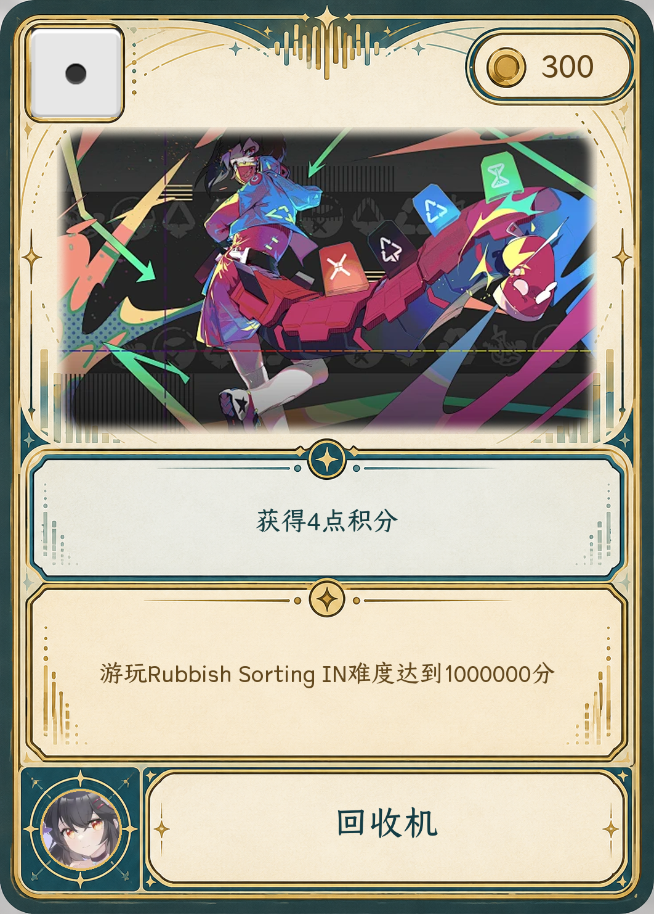
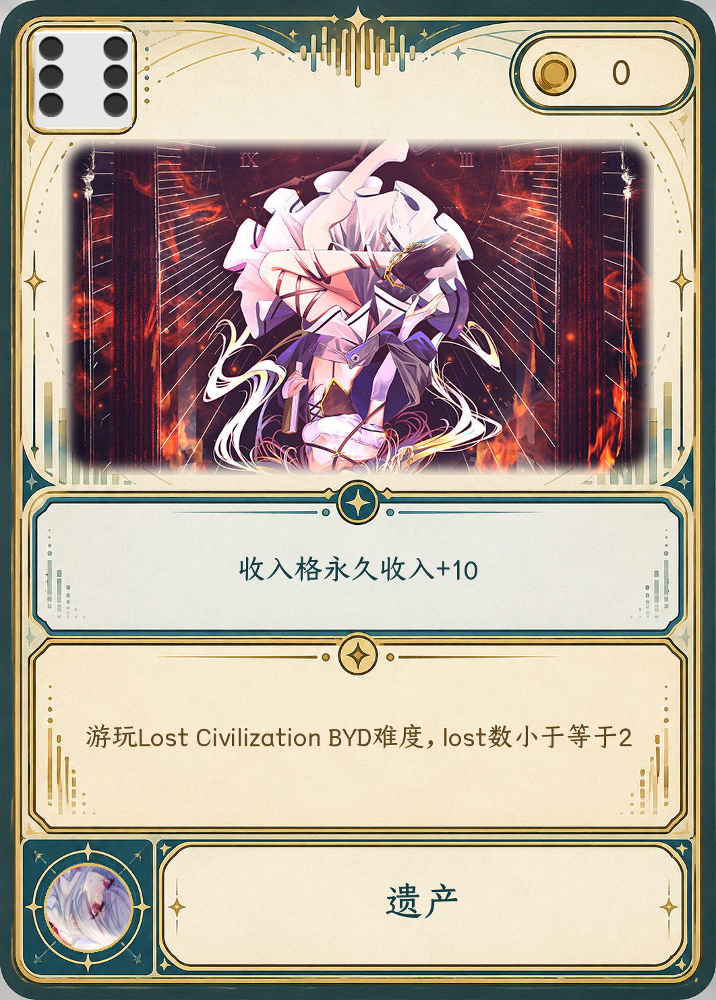
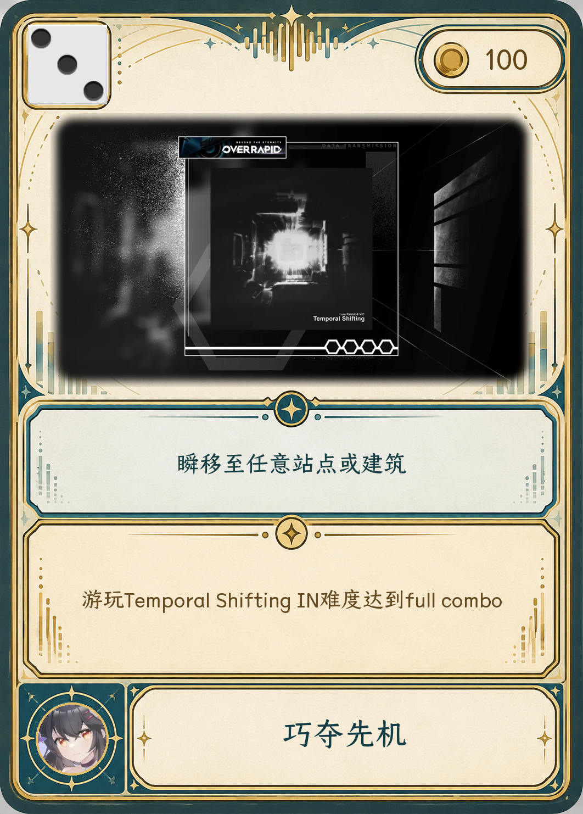
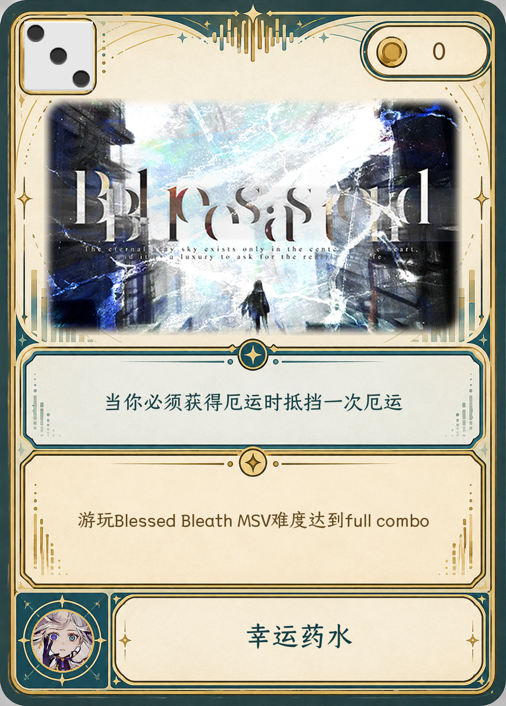
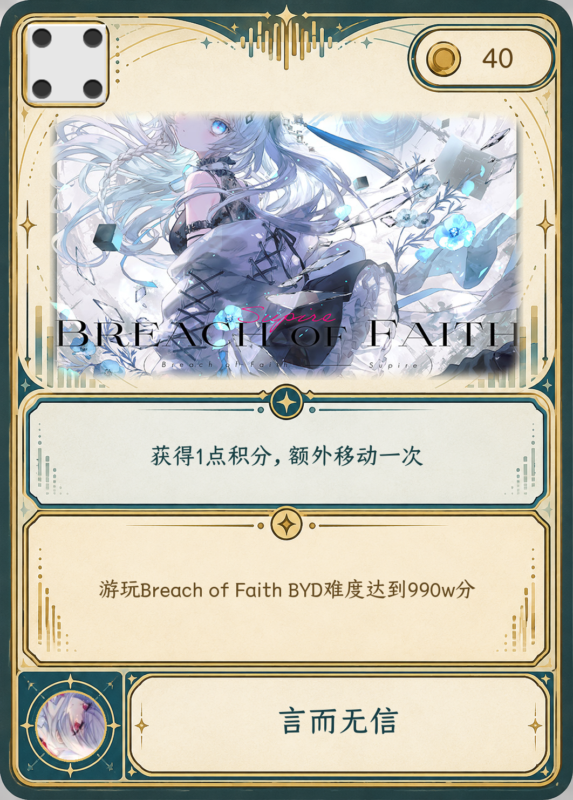
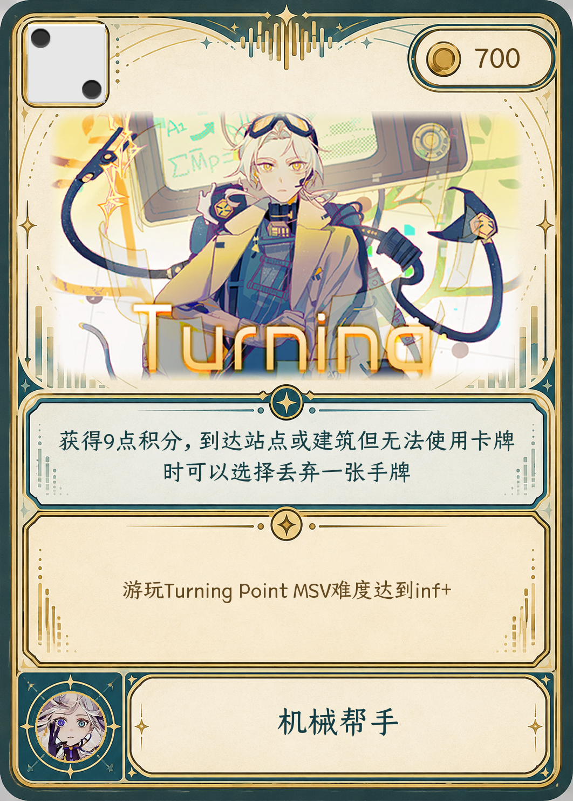
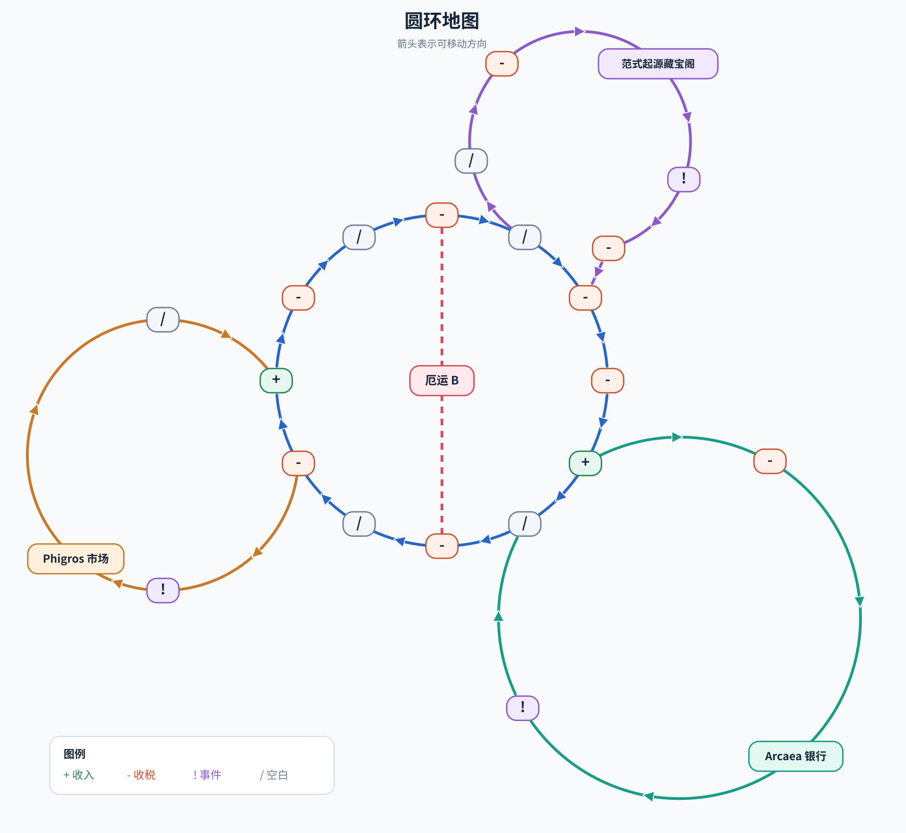
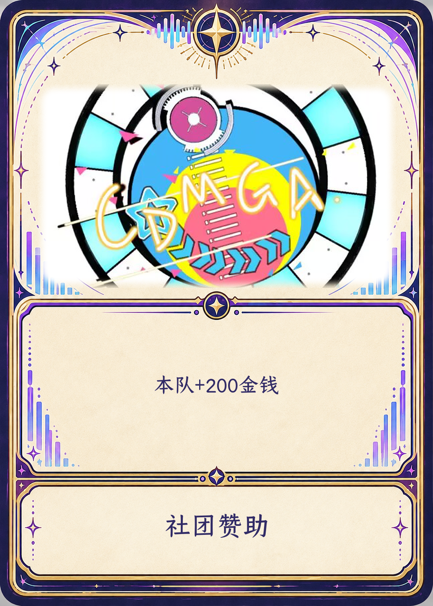
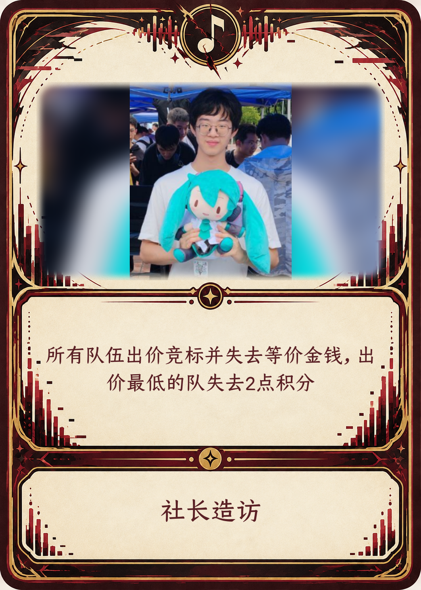

# 游戏规则

## 胜利条件

**达到 20 积分即满足胜利条件。** 较早轮次的战斗可能稍后结算，最终确认方式见文末“终局判定”。

## 资源

- 每队拥有积分、金钱和卡牌；初始积分、金钱及收入数值由赛前公布。
- **积分**来自战斗、事件和卡牌，可在市场兑换金钱,0分时不允许兑换。扣分后积分最低为 0。
- **金钱**来自收入格、房屋及卡牌，用于卡牌费用和银行升级。金钱最低为 0；余额不足时不能支付主动发动费用，强制扣款最多扣至 0。
- 每队保持 **6 张手牌**，每消耗一张立即补一张。

## 手牌

每张手牌标有左上角移动点数、右上角使用费用、左下角使用地点，正中间使用效果与条件。打出时选择**移动**或**使用**，不能两用：移动按点数走并弃牌；使用仅限停在适用房屋且支付发动费用后使用，然后达成条件后即可获得卡面标注的效果。每消耗一张立即补一张，保持 6 张；牌库耗尽时洗匀弃牌堆作为新牌库。规则书建议发动费用为 100-1000 金钱；普通手牌的具体牌面及费用仍待赛前确定。

## 战斗

- 每队每轮**只占领移动终点**，经过的格子不占领；房屋内不战斗。战斗表以轮次为行、三个队伍为列，每条记录包含终点节点、到达时间和预定出战人。同一时间按登记顺序区分先后。
- 各队仅可见轮次不大于本队当前轮次、到达时间不晚于当前时间的记录。同轮同格只由先到的两队战斗；第一队该轮次占领该地点后继续游戏，第二队在该轮次到达占领格时触发，第三队若也在该轮次到达占领格则不参战。
- 每个三轮分组（`1–3`、`4–6` 等）中，同一成员只能被预定一次，即使没有实际战斗。战斗触发时双方预定成员出战，其他成员继续游戏；若有人正参战，则进入**待战**，等待该选手正在进行的战斗结束后立即开始战斗，结束后归队。
- 先到队伍决定游戏，难度须在赛前公布的区间内；裁判随机抽三首曲目，后到队伍选一首比赛。结束时立即结算：胜队 **+2 积分**，负队 **−2 积分**，最低为 0。

## 地图

节点名称与类型见[对照表](./node-types.csv)。地图上的普通格子只显示类型符号，不显示节点名称。

地图共有六种格子：

| 格子 | 地图标记 | 效果 |
| --- | --- | --- |
| 空白格 | `/` | 无额外效果。 |
| 收入格 | `+` | 经过时加收入数量的钱，踩到时获得双倍。 |
| 收税格 | `-` | 经过时扣20钱，踩到时扣双倍。 |
| 事件格 | `!` | 停留时在事件环节翻一张事件卡。 |
| 厄运格 | `厄运 B` | 路过、占领时分别触发厄运卡。 |
| 房屋 | 建筑名称 | 可触发手牌技能和房屋功能；路过时可提前结束移动并进入。房屋内不发生战斗。 |

房屋功能：在 **Arcaea**支付 （收入+10）数量 金钱，本队每次收入永久增加 10；在**范式起源**掷一颗 d6，1：+10金钱 2：+25金钱 3：+50金钱 4：+100金钱 5：+150金钱 6：+200金钱；在 **Phigros**按 1 积分兑换 200 金钱。在每种游戏的房屋使用的卡牌只会出现该游戏的曲目的挑战条件。上述数值按规则书建议采用，开赛前锁定。

起点：三个队伍在比赛开始时每个队伍随机从三个大建筑中的一个内出发。

## 事件卡

停在事件格时，翻一张事件卡，立即结算并弃置；额外移动按“每轮流程”的规则处理。

| 类别 | 卡名 | 效果 |
| --- | --- | --- |
| 正面 | 社团赞助 | 本队 +200 金钱。 |
| 正面 | 热搜出圈 | 本队 +2 积分。 |
| 正面 | 高手带练 | 本队下次战斗 +1 积分。 |
| 正面 | Arcaea 联动 | 视为完成一次银行收入升级，收入永久 +10。 |
| 正面 | 范式抽奖 | 触发一次范式起源建筑效果。 |
| 正面 | Phigros 甩卖 | 触发一次phigros建筑效果(可以选择不触发)。 |
| 正面 | 亲友助威 | 当前积分最低的队伍 +1 积分。 |
| 负面 | 冷场 | 本队 −2 积分，最低为 0。 |
| 负面 | 设备返修 | 本队 −150 金钱。 |
| 负面 | 对手阴招 | 本队下次战斗 −1 积分。 |
| 全局 | 风向突变 | 当前积分最高队 −2 分（最低为 0），最低队 +2 分。 |
| 全局 | 全员热练 | 所有队伍的下次战斗得分 +1。 |
| 全局 | 手感火热 | 抵消下一次获得的debuff,如果已有debuff,则抵消最近一次获得的debuff |

## 厄运卡

路过厄运格时，本队抽一张并承受；占领时，抽取两张厄运，本队选择一个队伍，被选择的队伍从两张厄运中选择一张让本队承受。扣分最低为 0。卡牌造成的位置变化按“每轮流程”的额外移动规则处理。

| 卡名 | 效果 |
| --- | --- |
| 设备故障 | 承受队损失 100 金钱。 |
| 门票涨价 | 承受队损失 200 金钱。 |
| 摊主讹诈 | 承受队损失 50% 金钱。 |
| 走音失误 | 承受队 −2 积分，最低为 0。 |
| 评委黑脸 | 承受队 −3 积分，最低为 0。 |
| 手抖限定 | 承受队下次战斗得分减半：胜 +1，负 −1。 |
| 禁赛警告 | 承受队下一个回合不得主动发动同格战斗；被其他队伍触发的战斗不受影响。 |
| 阴间谱面 | 承受队下次战斗的对手额外 +1 积分。 |
| 感冒失声 | 承受队 −1 积分，且下次战斗再 −1 积分。 |
| 偏差认知 | debuff:下一次战斗或挑战时，偏移量+200 |
| 手指受伤 | debuff:下一次战斗或挑战时，禁止使用食指 |

## 终局判定

- 队伍达到 20 分时暂定达标。此前轮次仍可能出现或结算战斗；待此前轮次所有可能影响该队积分的战斗确定并结算后，若积分仍不少于 20 分，确认获胜。
- 记录队伍**首次达到 20 分的轮次**作为免战起始轮次。从该轮起及之后的轮次，不再新触发该队参与的战斗；此前轮次的战斗仍可触发和结算。已经开始或结算的战斗不追溯取消。
- 如果此前轮次的战斗使该队跌回 20 分以下，该队继续游戏，但免战规则不撤销，也不补打免战期间跳过的战斗。该队再次达到 20 分时，以**再次达标的轮次**计算总回合数。
- 例如：A 队第 5 轮达到 20 分，第 5 轮及以后不再新触发其战斗。随后第 4 轮的战斗使 A 队跌回 18 分；A 队继续第 6、7 轮，仍不参与新战斗。若第 7 轮再次达到 20 分，总回合数按第 7 轮计算。
- 若有多队同时达到 20 分，达标总回合数较少者胜；若回合数相同则达标时间较早者胜。
- 比赛达到规定时间上限时，按积分高低判定名次。

## 每轮流程

各队独立推进，完成本轮即可进入下一轮，无需等待其他队伍。严格按以下顺序结算：

1. **移动与格子效果**：打一张牌，按左上角点数沿箭头移动，分岔口自行选路；弃牌并补一张。结算经过的收入、收税、厄运格及终点格效果。
2. **战斗表**：只登记移动终点的占领，判定本轮是否触发战斗。
3. **事件与卡牌效果**：停在事件格则翻一张事件卡并结算；停在房屋可选择支付费用使用手牌及房屋功能。
4. **终局检查**：检查是否达到 20 分及是否仍有较早轮次的相关战斗。

卡牌或事件造成的额外移动、后退、传送**只改变位置**，不触发沿途或终点的格子效果，不登记占领，也不触发战斗；暂按此规则执行。
